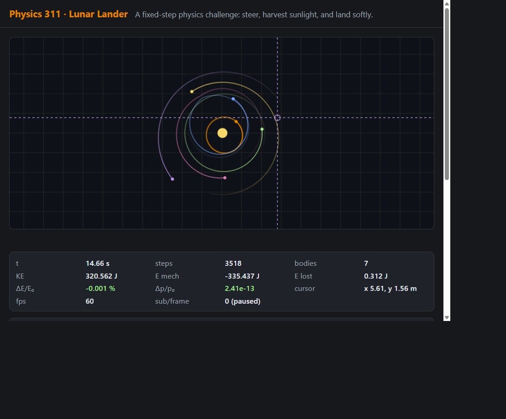

# Lab 10 Write-Up

## A1 — Coordinate verification

The pointer crosshair and HUD show the world-space coordinates for the same
canvas location. The screenshot records the orbit scene paused with the pointer
at **(5.61 m, 1.56 m)**.

The camera maps screen coordinates to world coordinates and back. The
`validate.js` camera check round-trips 400 points using an offset camera and
odd-sized viewport; its maximum error was **8.9 × 10⁻¹⁶ m**. A separate
high-DPI/CSS-scaling check maps the canvas corners to the expected world bounds.

## A3 — Timestep slider clamp

The timestep control is limited to **0.001–0.020 s**. The stiffest spring is
approximately \(k=2500\ \mathrm{N/m}\) for \(m=1\ \mathrm{kg}\), giving
\(\omega=\sqrt{k/m}=50\ \mathrm{rad/s}\). For a harmonic oscillator, the
Velocity Verlet stability condition is

\[
\Delta t\,\omega < 2
\quad\Longrightarrow\quad
\Delta t < \frac{2}{50}=0.040\ \mathrm{s}.
\]

The slider's 0.020 s upper bound is half that limit, providing a factor-of-two
safety margin for the stiffest modeled spring. The lower bound preserves a
useful responsive range without allowing an arbitrarily small step to demand
unbounded work per rendered frame.

## B1 — Teleport-drag analysis

Directly assigning a body's position bypasses the normal force, integration,
and collision steps. Two specific failures follow:

1. **Tunneling:** the test moves a radius-0.5 m body directly from \(x=-2\) m
   to \(x=+2\) m, across a stationary body at \(x=0\) m. After a physics step,
   the moved body is on the far side and the collision count is still zero.
2. **Missing collision impulse:** because the collision solver never sees the
   intermediate path, the bodies receive no impact impulse; the moved body's
   velocity remains zero. A direct position edit can also create overlap or
   change potential energy without corresponding physical work.

Dragging instead applies a pointer-spring force, so the body remains in the
physics and collision calculations.

## B2 — Visuals and what they reveal

- **Motion trails:** The fading trail reveals the recent path and direction of
  travel, making orbital shape and periodic motion easier to recognize.
- **Velocity vectors:** The arrows reveal each body's instantaneous direction
  and relative speed, which position snapshots alone cannot show.
- **Net-force vectors:** The arrows reveal the direction and relative magnitude
  of the net force acting on each body at that step.

## B3 — Accessibility report

- **Unplugged-mouse test passed:** using only the keyboard, I paused and reset
  the simulation, changed the gravity slider, and switched the integrator.
  From the canvas, Tab reaches the preset; four more Tabs reach Gravity, where
  Left/Right changes its value.
- The simulation canvas is keyboard-focusable and has a descriptive accessible
  name and fallback instructions. Controls have labels and visible focus
  indicators.
- Sliders expose descriptive value text, and a polite live region announces
  actions and scene changes.
- Lander controls support keyboard input and on-screen press-and-hold buttons.
- The reduced-motion preference disables trails; the layout reflows to one
  column on narrow screens.

## Part C — Lunar lander

**Purpose:** Turn the simulation into a landing challenge where a player must
steer a craft, manage a limited propulsion reserve, and land gently on a
specified pad.

**Physics topics used:**

1. **Gravity and fixed-step dynamics:** the craft accelerates under lunar
   gravity (\(1.62\ \mathrm{m/s^2}\)) and its motion is advanced with a
   fixed-step integrator.
2. **Thrust and energy transfer:** steerable retro-thrust changes the craft's
   velocity and drains its reserve; solar alignment replenishes that reserve.
   Powered flight is therefore an open system, not a closed-system energy
   conservation test.

**Quantitative validation:** An unpowered 60 s lunar free-fall run with
Velocity Verlet had relative mechanical-energy drift
**\(|\Delta E/E_0|=2.32\times10^{-13}\)**, below the test limit of \(10^{-8}\).
Separate impact checks accept an upright, low-speed touchdown within the pad
and classify a pad miss or a 3 m/s touchdown as a crash. These checks validate
the physics rules independently of the player's powered flight.

## Robustness log

| What I tried to break | What happened |
|---|---|
| Round-trip pixel/world coordinates with an offset camera and odd viewport dimensions | 400 points returned with a maximum error of \(8.9\times10^{-16}\) m. |
| Pointer mapping when the canvas is CSS-scaled and high-DPI | Both pointer corners mapped to the expected world-space bounds. |
| Deterministic reset | Two independently built runs remained bit-for-bit identical after 3,000 steps. |
| Different render-frame timing (60 Hz, 144 Hz, and jittery frames) | The runs reached approximately the same 10.0000 s simulated time; the 60 Hz and 144 Hz runs used 2,400 steps. |
| A 2 s frame/tab stall | The accumulator capped work at 8 substeps instead of attempting 480. |
| Direct-position “drag” across another body | The body tunneled through with zero collisions and zero velocity change; see B1. |
| Momentum during a pointer grab | Momentum changed while the external pointer force was applied; conservation returned to machine precision after release. |
| Energy bookkeeping at restitution 1, 0.95, 0.5, and 0 | Relative ledger drift stayed at or below \(8\times10^{-16}\). |
| Extremely fast slingshot drag | Launch speed was capped at 30 m/s. |
| Lander thrust and solar recharge | Thrust drained reserve; solar alignment replenished it without exceeding capacity. |
| Landing with different impact conditions | A safe pad touchdown landed; a miss and an over-speed touchdown crashed. |

The recorded numerical checks above are documented in `tests/validate.js` and
the project README. Node.js was unavailable in this session, so the headless
suite was not rerun while preparing this write-up.
